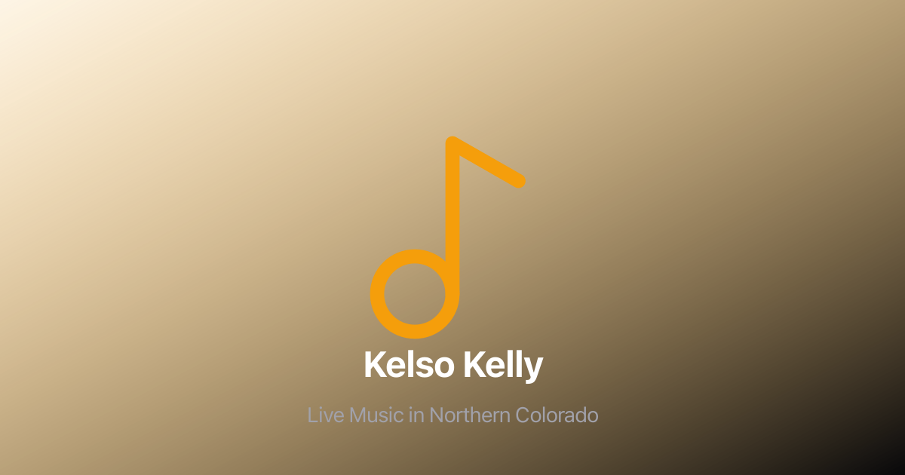
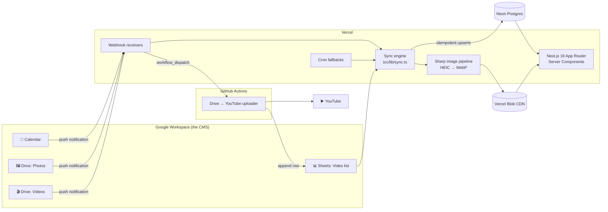

<div align="center">



# Kelso Kelly Music

**A production website for a working musician, built so he never has to touch it.**

He updates a Google Calendar, drops photos into a Drive folder, or adds a video to a Drive folder, and the site updates itself within seconds.

[](https://github.com/CaseyKelly/kelso-kelly-site/actions/workflows/ci.yml)


### [kelsokellymusic.com →](https://www.kelsokellymusic.com)

</div>

---

## The problem

Kelso Kelly has been on stage for 40+ years playing pop, old-school R&B, and modern country across Northern Colorado. He isn't going to learn a CMS, and he shouldn't have to. He already uses Google Calendar for his gigs, his phone's camera roll for photos, and Google Drive for everything else.

So the site treats **Google Workspace as the CMS**. No admin panel, no logins, no "can you update the website for me?" texts.

| He does this… | …and the site does this |
| --- | --- |
| Adds a gig to Google Calendar | The **Schedule** page shows it in seconds |
| Drops photos (even iPhone HEIC files) into a Drive folder | They're converted, resized to WebP, pushed to a CDN, and appear in the **Media** gallery |
| Drops a raw video file into a Drive folder | A GitHub Actions job uploads it to YouTube and the video shows up on the site |

## Architecture



**Google is the source of truth for content; Postgres is the source of truth for the website.** Pages never call Google APIs at request time. They read from the database and are revalidated on demand whenever a sync changes something, so they stay fast and keep working even if a Google API is having a bad day.

## Engineering highlights

### ⚡ Real-time sync with self-healing webhooks
Google Calendar and Drive push change notifications to webhook endpoints the moment content changes. Those subscriptions expire (Calendar after 7 days, Drive after 24 hours), so a cron job renews them automatically. If a channel is lost or never created, the renewal job notices the gap and **recreates it on its next run**, so the system recovers on its own within 12 hours. Webhook URLs are public, so each incoming notification is checked against the channels stored in the database, and forged requests are rejected before they can trigger any work. Failed renewals, duplicates, and expired channels trigger email alerts.

### 🔁 Belt-and-suspenders delivery
Webhooks handle the fast path and Vercel cron jobs act as a safety net, so a dropped notification never means stale content. A database-backed throttle (`sync_log`) keeps webhook bursts from stampeding the sync, and because it lives in Postgres it still works across serverless cold starts.

### 🧠 Idempotent upserts that know what changed
Every sync uses a single SQL statement that inserts, updates, **or does nothing**, and reports which one happened:

```sql
INSERT INTO events (...) VALUES (...)
ON CONFLICT (google_event_id) DO UPDATE SET ...
WHERE events.title IS DISTINCT FROM EXCLUDED.title OR ...
RETURNING *, (xmax = 0) AS inserted
```

Unchanged rows are skipped entirely, so `updated_at` stays meaningful and re-running a sync is always safe.

### 🖼️ Image pipeline that handles whatever a phone throws at it
Photos are downloaded from Drive, auto-converted from HEIC (detected by the file's ISO-BMFF brand, not just its extension), resized to a max of 1920px, re-encoded as WebP with Sharp, and served from Vercel Blob. Photos that were already processed skip the expensive work, and metadata updates are batched to avoid N+1 queries.

### 🎬 YouTube uploads off the request path
The YouTube Data API won't accept service-account credentials for uploads, and large video files would blow through a serverless function's time limit. So the Drive webhook instead fires a `workflow_dispatch` that runs the upload on a GitHub Actions runner with a two-hour budget, using a stored OAuth refresh token. A 6-hour scheduled run catches anything the webhook misses.

### 🔍 SEO and observability
The site ships with JSON-LD structured data, a generated sitemap and `robots.txt`, and Open Graph/Twitter cards so it ranks for local searches like *"live musician Fort Collins"*. Sentry covers the server, edge, and browser runtimes, plus a global error boundary, and Vercel Analytics tracks traffic.

## Testing

Five CI jobs gate every pull request:

| Job | What it covers |
| --- | --- |
| **Lint + typecheck** | ESLint and strict `tsc --noEmit` |
| **Unit tests** | Vitest + Testing Library for the sync engine, Google API clients, image optimizer, webhooks, throttling, and React components, with coverage reports |
| **DB integration** | Runs the real upsert SQL against a **Postgres 18** service container |
| **Build** | Full `next build` |
| **E2E** | Playwright drives Chromium through every page, backed by a seeded Postgres |

**The interesting bit:** the Neon serverless driver only talks HTTP to Neon's hosted proxy. It has no way to connect to a plain Postgres instance. Rather than mock the database layer (and stop testing the SQL that matters most), [`scripts/neon-http-bridge.js`](scripts/neon-http-bridge.js) reimplements Neon's `/sql` HTTP protocol on top of `pg`. That lets integration and E2E tests run the production `db.ts` code, **completely unmodified**, against a real database.

Dependencies stay current through Renovate, with CI as the gate.

## Tech stack

| Layer | Tools |
| --- | --- |
| **Framework** | Next.js 16 (App Router, Server Components, ISR), React 19, TypeScript |
| **Styling** | Tailwind CSS 4, Lucide icons |
| **Data** | Neon serverless Postgres, Vercel Blob |
| **Integrations** | Google Calendar, Drive, and Sheets APIs, YouTube Data API, Resend (email) |
| **Media** | Sharp, heic-convert |
| **Infra** | Vercel (hosting + cron), GitHub Actions |
| **Quality** | Vitest, Testing Library, Playwright, ESLint, Sentry, Renovate |

## Project structure

```
src/
├── app/
│   ├── (site)/            # Public pages: home, bio, schedule, media, songs, contact
│   └── api/
│       ├── webhook-*/     # Google push-notification receivers
│       ├── sync-*/        # Sync triggers (cron + manual)
│       ├── cron/          # Webhook renewal + self-healing
│       ├── contact/       # Contact form → Resend
│       └── revalidate/    # On-demand ISR
├── components/            # Layout + UI primitives
└── lib/
    ├── sync.ts            # Calendar, photo, and video sync pipelines
    ├── db.ts              # Typed Neon queries + change-detecting upserts
    ├── webhooks.ts        # Subscription setup, renewal, recovery
    ├── image-optimizer.ts # Sharp + HEIC → WebP
    └── google-*.ts        # Google API clients
scripts/                   # YouTube uploader, Neon HTTP bridge, image tools
db/                        # Schema, migrations, test seed
e2e/                       # Playwright specs
```

## Running locally

```bash
git clone https://github.com/CaseyKelly/kelso-kelly-site.git
cd kelso-kelly-site
npm install
# create .env.local with Neon, Google service account, and Resend credentials
npm run dev                  # http://localhost:3000
```

```bash
npm test                 # unit tests
npm run test:integration # needs TEST_DATABASE_URL pointing at a Postgres instance
npm run test:e2e         # Playwright
npm run typecheck && npm run lint
```

[`SETUP_GUIDE.md`](SETUP_GUIDE.md) covers the full environment and Google Cloud setup (service account, calendar sharing, webhook registration).

---

<div align="center">

Built and maintained by [Casey Kelly](https://github.com/CaseyKelly)

</div>
